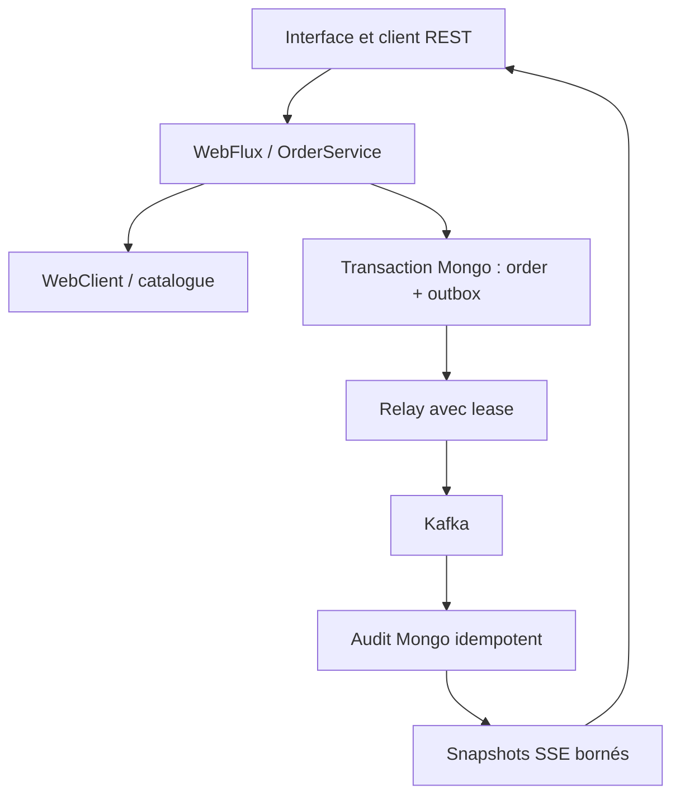

# Reactive Orders Lab — apprendre Spring WebFlux en construisant

Un projet pédagogique pour **Wael**, développeur full-stack Java : une petite application de commandes proche d'un contexte supply chain. L'objectif est de comprendre **pourquoi** une chaîne réactive fonctionne, comment elle échoue, et où placer les garanties métier.

**Java 21 · Spring Boot 4.1.2 · Reactor · WebFlux/Netty · MongoDB réactif · Spring Kafka · Docker · JUnit/StepVerifier · Playwright**

Le code et les guides sont en français. Les opérateurs réactifs, les frontières bloquantes, les transactions et les dépendances sont commentés au point où ils sont utilisés. Les commentaires expliquent un comportement ou une décision ; les imports et accolades ne sont pas paraphrasés.

## Ce que l'application fait

- Créer une commande après consultation d'une API catalogue par `WebClient`.
- Rejouer une création avec la même `Idempotency-Key` sans créer de doublon ; refuser la même clé avec un autre contenu.
- Consulter et paginer les commandes, puis les annuler de façon idempotente.
- Enregistrer atomiquement la commande et son événement dans MongoDB.
- Publier les événements vers Kafka avec un relay d'outbox, retries durables et lease.
- Consommer les événements dans un audit Mongo dédupliqué par identifiant d'événement.
- Suivre les 20 derniers audits dans l'interface via des snapshots SSE.
- Envoyer les messages invalides dans une DLT et conserver les outbox en échec pour diagnostic.

Le catalogue est une API WireMock contrôlée, avec quatre références. `available=true` indique la disponibilité annoncée ; **ce projet ne réserve pas un stock réel**. Les montants sont en centimes EUR et une commande contient une seule ligne pour concentrer l'apprentissage.

## Démarrage rapide : tout dans Docker

Prérequis : Git, Docker Engine ou Docker Desktop avec Compose v2, environ 4 Go de mémoire disponibles pour la stack. Java et Node sur l'hôte ne sont pas nécessaires pour ce premier lancement.

```bash
git clone --branch feat/reactive-orders-lab https://github.com/WaelOuni/order-tracking-multi.git
cd order-tracking-multi/reactive-orders-lab
docker compose up -d --build --wait --wait-timeout 240
```

Ouvrir **http://localhost:8080**. Une première construction télécharge les images et les dépendances ; elle est plus longue que les suivantes.

```bash
docker compose logs -f app
docker compose stop
# Pour retirer les conteneurs en conservant les données :
docker compose down
```

`docker compose down --volumes` efface les données de ce lab : ne l'utiliser que pour une remise à zéro volontaire. La stack se lie à `127.0.0.1`. C'est un atelier local, avec un broker et un nœud Mongo, sans authentification utilisateur ni haute disponibilité.

### Développement depuis IntelliJ / VS Code / WSL

Installer un **JDK 21**, puis ouvrir le `pom.xml` de ce dossier comme projet Maven.

```bash
docker compose up -d --wait mongo kafka catalog
./mvnw spring-boot:run
```

Dans PowerShell, remplacer `./mvnw` par `./mvnw.cmd`. Le wrapper télécharge Maven 3.9.11 ; inutile d'installer Maven séparément. Les adresses par défaut sont Mongo `27017`, Kafka `9092`, catalogue `8089`, application `8080`. Les variables et les diagnostics sont expliqués dans [Docker et CI](docs/04-docker-et-ci.md).

## Le chemin d'une commande



Le domaine est du Java sans Spring. L'application compose des ports réactifs. Les adaptateurs connaissent HTTP, MongoDB et Kafka. La configuration assemble ces classes. Il s'agit d'un **monolithe modulaire avec architecture hexagonale et DDD simple**, pas d'une démonstration de microservices distribués.

| Dossier Java | Responsabilité | Premier fichier à ouvrir |
| --- | --- | --- |
| `domain` | Agrégat, invariants, événements, valeurs métier | [`Order.java`](src/main/java/fr/wael/reactiveorders/domain/Order.java) |
| `application` | Cas d'usage et orchestration réactive | [`OrderService.java`](src/main/java/fr/wael/reactiveorders/application/OrderService.java) |
| `application/port` | Contrats des dépendances sortantes | [`OrderStore.java`](src/main/java/fr/wael/reactiveorders/application/port/OrderStore.java) |
| `adapter/in/web` | DTO REST, validation, erreurs, SSE | [`OrderController.java`](src/main/java/fr/wael/reactiveorders/adapter/in/web/OrderController.java) |
| `adapter/out/http` | Appels catalogue, timeout et retry filtré | [`WebClientCatalog.java`](src/main/java/fr/wael/reactiveorders/adapter/out/http/WebClientCatalog.java) |
| `adapter/out/mongo` | Documents, index, versions, transactions | [`MongoOutboxStore.java`](src/main/java/fr/wael/reactiveorders/adapter/out/mongo/MongoOutboxStore.java) |
| `adapter/out/kafka` | Frontière Kafka adaptée à Reactor | [`KafkaEventPublisher.java`](src/main/java/fr/wael/reactiveorders/adapter/out/kafka/KafkaEventPublisher.java) |
| `adapter/in/kafka` | Consommation asynchrone vers l'audit | [`OrderEventsListener.java`](src/main/java/fr/wael/reactiveorders/adapter/in/kafka/OrderEventsListener.java) |
| `configuration` | Assemblage, bornes réseau, DLT, headers HTTP | [`ApplicationConfiguration.java`](src/main/java/fr/wael/reactiveorders/configuration/ApplicationConfiguration.java) |

## Parcours conseillé pour apprendre

1. Lancer l'application et créer deux commandes, puis en annuler une.
2. Lire [`ReactorLearningTest`](src/test/java/fr/wael/reactiveorders/learning/ReactorLearningTest.java), prédire chaque résultat, puis exécuter `./mvnw -Dtest=ReactorLearningTest test`.
3. Suivre la méthode `OrderService.create` avec [Reactor pas à pas](docs/01-reactor-pas-a-pas.md).
4. Lire [architecture et dépendances](docs/02-architecture-et-dependances.md), puis le `pom.xml` commenté.
5. Étudier [la fiabilité Mongo/Kafka](docs/03-fiabilite-mongo-kafka.md), en particulier la fenêtre de crash après l'ack Kafka.
6. Explorer [Docker et la CI](docs/04-docker-et-ci.md), puis [l'UI et les tests](docs/05-ui-et-tests.md).
7. Faire les [exercices progressifs](docs/06-exercices.md), sans lire immédiatement les pistes de correction.

## API REST : exemples reproductibles

Le corps JSON est obligatoire pour une création. La clé d'idempotence est un UUID choisi par le client et sert d'identité de commande dans ce lab. Une clé ne doit jamais être réutilisée pour une nouvelle intention.

```bash
curl -i http://localhost:8080/api/orders \
  -H 'Content-Type: application/json' \
  -H 'Idempotency-Key: 31605974-a58e-40e6-8b89-e81e1ff231fe' \
  -d '{"customerRef":"CLIENT-DEMO","sku":"KEYBOARD","quantity":2}'

curl 'http://localhost:8080/api/orders?page=0&size=10'

curl -i -X POST \
  'http://localhost:8080/api/orders/31605974-a58e-40e6-8b89-e81e1ff231fe/cancel' \
  -H 'Content-Type: application/json'

curl -N http://localhost:8080/api/events
```

L'annulation exige le header JSON même sans corps. Cela évite un POST simple depuis un autre site vers le service local ; ce n'est pas une authentification. Aucun CORS permissif n'est configuré.

| Opération | Réponse attendue |
| --- | --- |
| Créer ou rejouer une création identique | `201`, même `id`, header `Location` ; état courant de la commande |
| Rejouer une clé avec un contenu différent | `409` |
| Quantité hors bornes / JSON ou UUID invalide | `400` |
| Produit/commande absent | `404` |
| Produit indisponible | `422` |
| Catalogue en panne après retries bornés | `503` |
| Annulation avec version devenue obsolète | `409`, recharger puis réessayer |
| Snapshot SSE | `text/event-stream`, événement `snapshot` contenant un tableau d'audits |

La pagination accepte `page=0..1000` et `size=1..50`. Elle utilise un offset borné : des insertions concurrentes peuvent déplacer les pages. Le guide propose ensuite un exercice de pagination par curseur.

## Les tests et ce qu'ils prouvent

```bash
# Sans Docker : domaine, Reactor, application, REST simulé, HTTP réel vers MockWebServer, architecture.
./mvnw verify

# Avec Docker : ajoute Mongo replica set + Kafka réels, transactions, concurrence, DLT, SSE.
./mvnw verify -Pintegration

# Avec Node.js 24 et Chromium : vraie UI, API contrôlée dans les tests.
npm ci
npx playwright install chromium
npm run test:ui

# Vrai parcours navigateur contre la stack démarrée sur localhost:8080.
npm run test:live
```

Les tests `*IT` ne sont **jamais ignorés automatiquement** si Docker est absent. Ils ne sont lancés que lorsque le profil `integration` est explicitement demandé ; ce profil doit échouer si son infrastructure manque. La CI lance ce profil et le parcours navigateur réel.

Les scénarios métier sont écrits en **Given / When / Then avec JUnit**. Ils constituent une approche BDD lisible et exécutée ; le projet n'ajoute pas Cucumber ni une fausse suite Gherkin non exécutée.

Les attentes `.block(Duration)` sont autorisées dans les tests d'intégration sur les threads JUnit. Une règle ArchUnit interdit `block`, `blockFirst` et `blockLast` dans le code de production. Le rapport JaCoCo est généré sous `target/site/jacoco/` ; on privilégie les garanties testées plutôt qu'un pourcentage artificiel.

Consulter [le bilan de validation](docs/07-validation.md) pour distinguer tests exécutés, suites fournies et limites de l'environnement de création.

## Décisions importantes

- **Pas de `spring-boot-starter-web` ni de JPA** : Netty, WebClient et Mongo utilisent ici une chaîne d'I/O réactive.
- **Pas de Reactor Kafka** : son arrêt a été annoncé en 2025. `KafkaTemplate.send` est adapté avec `fromCallable` et `boundedElastic`, puis sa future est composée sans attendre de manière bloquante.
- **Pas de `subscribe()` dans les services** : WebFlux, Spring Kafka et le scheduler possèdent les souscriptions et le cycle de vie.
- **Pas de double écriture Mongo/Kafka supposée atomique** : une transaction écrit commande + outbox ; le broker est alimenté ensuite.
- **Livraison au moins une fois** : un crash après l'ack Kafka peut produire un doublon. L'audit utilise une contrainte unique, et non un fragile `exists` suivi d'un `insert`.
- **Pas d'affirmation “exactly once” de bout en bout** : l'idempotence du producer Kafka n'élimine pas les renvois applicatifs.
- **Bornes explicites** : page, pool WebClient, mémoire de décodage, taille de batch, polling, durée d'attente et nombre de retries.
- **DDD proportionné** : un agrégat clair et des ports ; une base et un processus suffisent à apprendre ces mécanismes.

## Limites assumées avant un déploiement réel

Ajouter une authentification OAuth2/OIDC, l'autorisation par propriétaire, TLS, des identifiants Mongo/Kafka et leur gestion de secrets. Définir une politique d'accès aux métriques et traces, une rétention métier des audits, une procédure de réexécution des FAILED/DLT et des tests de charge. Dimensionner les clusters, la réplication et les connexions SSE. Le polling SSE est volontairement simple et coûte une requête Mongo par seconde et par client ; il ne constitue pas une architecture destinée à des dizaines de milliers de connexions.

Le repo ne contient ni secret, ni données ADEO, ni données personnelles réelles. Utiliser des références clients fictives dans le lab.

## Sources de référence

- [Spring Boot 4.1.2 et versions gérées](https://docs.spring.io/spring-boot/appendix/dependency-versions/coordinates.html)
- [Reactor : guide et FAQ](https://projectreactor.io/docs/core/release/reference/)
- [Spring WebFlux](https://docs.spring.io/spring-framework/reference/web/webflux.html)
- [Fin de maintenance de Reactor Kafka](https://spring.io/blog/2025/05/20/reactor-kafka-discontinued/)
- [Retours asynchrones Spring Kafka](https://docs.spring.io/spring-kafka/reference/kafka/receiving-messages/async-returns.html)
- [Transactions Mongo réactives](https://docs.spring.io/spring-data/mongodb/reference/mongodb/client-session-transactions.html)
- [Testcontainers](https://java.testcontainers.org/) et [Playwright](https://playwright.dev/docs/intro)
