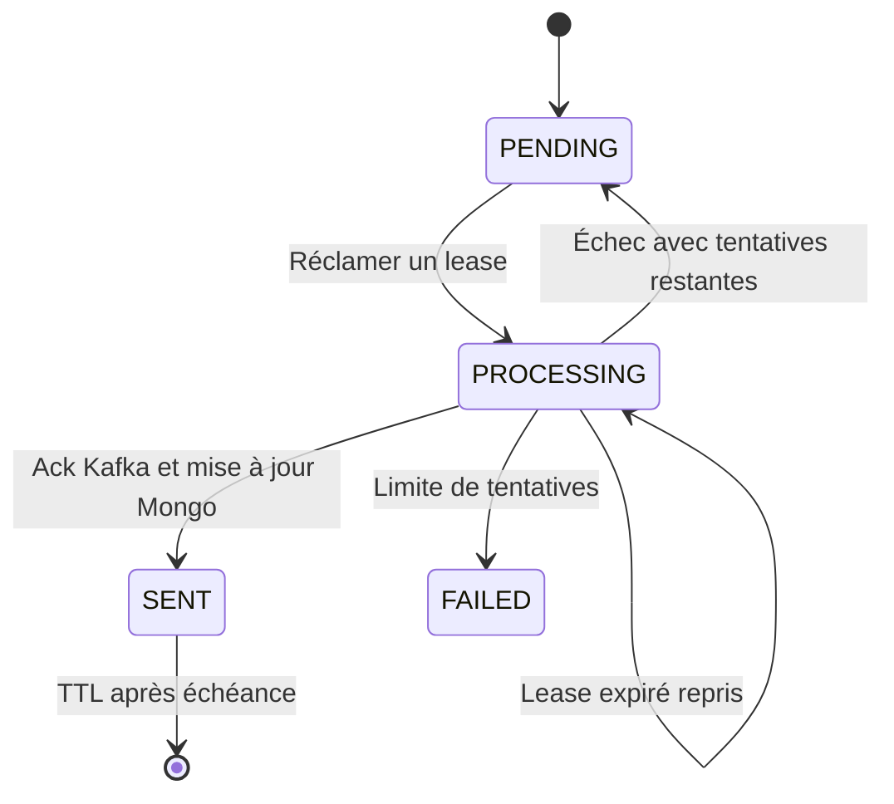

# 03 — Fiabilité MongoDB, outbox et Kafka

Ce laboratoire sépare trois faits : **la commande a été enregistrée**, **l'événement a été accepté par Kafka**, et **le consommateur l'a enregistré dans l'audit**. Ils ne surviennent pas au même instant et n'ont pas la même garantie. Le navigateur observe ensuite des snapshots de cet audit.

Le projet met en œuvre une transaction Mongo, une livraison Kafka pouvant être répétée et un consommateur idempotent. Il ne prétend pas réaliser une transaction distribuée « exactly once » entre HTTP, Mongo, Kafka et le navigateur.

## 1. Les responsabilités du code

| Responsabilité | Implémentation |
|---|---|
| Règles de commande et immutabilité | [Order](../src/main/java/fr/wael/reactiveorders/domain/Order.java) |
| Création, rejeu et annulation | [OrderService](../src/main/java/fr/wael/reactiveorders/application/OrderService.java) |
| Transaction réactive | [MongoUnitOfWork](../src/main/java/fr/wael/reactiveorders/adapter/out/mongo/MongoUnitOfWork.java), [ApplicationConfiguration](../src/main/java/fr/wael/reactiveorders/configuration/ApplicationConfiguration.java) |
| Version de commande | [OrderDocument](../src/main/java/fr/wael/reactiveorders/adapter/out/mongo/OrderDocument.java), [MongoOrderStore](../src/main/java/fr/wael/reactiveorders/adapter/out/mongo/MongoOrderStore.java) |
| Réclamation et état d'outbox | [MongoOutboxStore](../src/main/java/fr/wael/reactiveorders/adapter/out/mongo/MongoOutboxStore.java) |
| Tentatives et budgets de publication | [OutboxRelay](../src/main/java/fr/wael/reactiveorders/application/OutboxRelay.java) |
| Frontière producteur Kafka | [KafkaEventPublisher](../src/main/java/fr/wael/reactiveorders/adapter/out/kafka/KafkaEventPublisher.java) |
| Consommation et audit | [OrderEventsListener](../src/main/java/fr/wael/reactiveorders/adapter/in/kafka/OrderEventsListener.java), [MongoAuditStore](../src/main/java/fr/wael/reactiveorders/adapter/out/mongo/MongoAuditStore.java) |
| Retries du consommateur et DLT | [KafkaConfiguration](../src/main/java/fr/wael/reactiveorders/configuration/KafkaConfiguration.java) |

## 2. Pourquoi une outbox

Supposons que l'on fasse simplement `saveOrder().then(sendToKafka())` :

- Mongo réussit, puis le processus tombe avant Kafka : la commande existe, son événement est perdu.
- Kafka accepte l'événement, puis la connexion se coupe : le producteur ignore si un nouvel envoi fera doublon.
- Inverser les appels ne résout rien : Kafka pourrait annoncer une commande dont l'écriture Mongo a échoué.

Dans le projet, `orders` et `outbox` sont deux collections de **la même base Mongo**. La création enregistre la commande et son événement dans une transaction locale. L'annulation modifie la commande et ajoute son événement dans une autre transaction locale. En cas d'échec d'une écriture, les deux effets sont annulés.

La publication Kafka intervient plus tard, hors de cette transaction. L'événement reste dans Mongo tant que le relay ne sait pas le marquer comme envoyé, ou reste visible en état `FAILED` après épuisement des tentatives.

Cela transforme un trou de livraison non observable en un travail durable à reprendre. La possibilité de publier deux fois reste réelle ; c'est le rôle de l'idempotence côté consommateur.

## 3. Périmètre précis de la transaction

Dans `OrderService.create`, la séquence est :

1. Chercher une commande portant la clé de requête.
2. Si elle existe, vérifier la compatibilité du contenu et la retourner.
3. Sinon, obtenir le produit et son prix auprès du catalogue HTTP.
4. Construire l'agrégat après validation de ses règles.
5. Ouvrir la transaction réactive pour insérer `orders` puis `outbox`.
6. Terminer la transaction avant de rendre le résultat à WebFlux.

L'appel catalogue reste hors transaction : il n'est pas un participant transactionnel et son attente allongerait inutilement la durée de la session Mongo. Le prix enregistré est un snapshot du catalogue ; `available=true` n'est pas une réservation de stock.

`ReactiveMongoTransactionManager` associe la session Mongo au contexte Reactor. `TransactionalOperator` contrôle son cycle de vie. `MongoUnitOfWork` retourne le publisher composé, sans `subscribe()` indépendant. Les transactions Mongo multi-documents demandent un replica set, fourni par Compose et par les tests Testcontainers.

Une erreur de commit peut laisser le client dans l'incertitude : il ne faut pas en déduire que toute l'opération a forcément échoué côté serveur. Le code traduit les conflits d'écriture Mongo de code `112` en conflit applicatif. Il ne met pas en œuvre un mécanisme complet de reprise automatique de toutes les erreurs de commit ou de toutes les étiquettes d'erreurs transactionnelles Mongo. La reprise client doit conserver la même clé d'idempotence.

Sources : [transactions Mongo](https://www.mongodb.com/docs/manual/core/transactions/), [sessions et transactions réactives Spring Data](https://docs.spring.io/spring-data/mongodb/reference/mongodb/client-session-transactions.html).

## 4. Idempotence de la requête HTTP

Le header `Idempotency-Key` contient un UUID. Cet UUID devient l'identifiant de la commande. `MongoOrderStore.insert` utilise une insertion, et non un upsert susceptible d'écraser une ressource existante.

| Situation | Comportement |
|---|---|
| Nouvelle clé | Créer une commande et son événement |
| Même clé, mêmes `customerRef`, `sku` et `quantity` | Retrouver la commande existante |
| Même clé, contenu différent | HTTP 409 |
| Réponse perdue après commit | Refaire la demande avec la même clé pour retrouver la ressource |
| Deux créations simultanées avec la même clé | L'unicité de `_id` empêche deux commandes ; relecture après un doublon reconnu |

Une lecture préalable ne protège pas à elle seule contre la concurrence. Deux requêtes peuvent lire « absent » en même temps ; la contrainte d'unicité décide laquelle écrit. Après une collision reconnue, la relecture s'effectue à l'extérieur de la transaction avortée. Un autre conflit transactionnel peut encore demander un rejeu par le client.

Le rejeu retourne la ressource existante, y compris son état actuel si elle a été annulée entre-temps. L'API renvoie également 201 pour ce rejeu : c'est le contrat retenu par `OrderController`. Changer cette convention pour 200 serait possible, mais exigerait une distinction explicite entre création et rejeu.

Le projet ne supprime pas les commandes et ne définit donc pas de durée d'expiration de ces clés. Une future politique de purge devra traiter cette question : supprimer une commande permettrait de réutiliser son ancien identifiant, sauf conservation d'un registre d'idempotence distinct.

## 5. `@Version` évite l'écrasement silencieux

`OrderDocument.version` est un `Long` annoté `@Version`. Un nouvel agrégat porte `null`, puis Spring Data initialise la version lors de l'insertion. Une sauvegarde d'un document existant inclut la version attendue dans le filtre et l'incrémente.

Exemple avec deux lecteurs :

| Étape | Client A | Client B | État Mongo |
|---|---|---|---|
| Lecture | Charge version 0 | Charge version 0 | Version 0 |
| Modification A | Sauvegarde avec version 0 | — | Version 1 |
| Modification B | — | Tente une sauvegarde avec version 0 | Aucun document correspondant |
| Résultat | Succès | Conflit à traiter | La version 1 reste conservée |

Le domaine renvoie un nouvel objet pour l'annulation. L'application persiste cet objet et crée l'événement à partir de la version effectivement sauvegardée. Si la sauvegarde échoue, aucun événement d'annulation n'est validé dans l'outbox.

Une annulation répétée après succès retourne directement la commande déjà annulée et ne crée pas de nouvel événement. Deux annulations réellement concurrentes peuvent produire un conflit pour l'une : recharger puis répéter l'intention est différent d'écraser aveuglément le document.

Source : [verrouillage optimiste Spring Data MongoDB](https://docs.spring.io/spring-data/mongodb/reference/mongodb/template-crud-operations.html#mongo-template.optimistic-locking).

## 6. Les états durables de l'outbox



Chaque document contient un `eventId`, l'événement, son état, un compteur de tentatives, une date de prochaine tentative et, pendant le traitement, un token et une expiration de lease.

`MongoOutboxStore.claim` utilise `findAndModify` : rechercher un événement éligible et lui attribuer un propriétaire constituent une opération atomique. Un événement est éligible si :

- il est `PENDING` et sa date de prochaine tentative est passée ;
- ou il est `PROCESSING` mais son lease est expiré.

La modification passe le document en `PROCESSING`, pose le token, fixe l'expiration et incrémente `attempts`. Le compteur mesure donc des **réclamations de travail**, pas un nombre exact d'envois réseau : un processus peut tomber après la réclamation et avant l'appel Kafka.

Le tri `createdAt`, puis `_id`, donne une sélection déterministe des candidats. Il ne constitue pas une garantie d'ordre métier par commande : des dates peuvent être égales, un premier événement peut attendre son prochain retry et plusieurs instances peuvent travailler simultanément.

## 7. Lease de 60 secondes et attente de publication de 15 secondes

Les budgets sont visibles dans `OutboxRelay` et `application.yml` :

| Réglage | Valeur du laboratoire | Portée |
|---|---:|---|
| Lease outbox | 60 s | Droit temporaire de reprendre ce document |
| Timeout du publisher dans le relay | 15 s | Attente locale du résultat Kafka |
| Kafka `max.block.ms` | 2 000 ms | Certaines attentes de l'invocation de `send` |
| Kafka `request.timeout.ms` | 5 000 ms | Attente d'une requête broker |
| Kafka `delivery.timeout.ms` | 10 000 ms | Budget de livraison du producteur |
| Taille maximale d'un passage | 20 événements par défaut | Travail demandé par une instance |
| Tentatives avant `FAILED` | 10 par défaut | Reprises contrôlées par le relay |

La marge entre 15 et 60 secondes réduit les reprises concurrentes normales. Elle ne prouve pas que toute l'opération tiendra dans le lease : les opérations Mongo, une pause JVM, une machine suspendue et la dérive des horloges restent à considérer. Le timeout de 15 secondes porte sur `publisher.publish`, pas sur le passage entier ni sur le marquage Mongo final.

Le token protège la finalisation. `markPublished` filtre par `_id`, état `PROCESSING` et token. Si un autre worker a repris l'événement, l'ancien ne peut plus le marquer à sa place ; il reçoit `LostLease`. `reschedule` utilise la même condition de propriété. S'il ne possède plus le document, sa mise à jour ne touche rien.

La possession n'annule pas un envoi déjà parti vers Kafka. Un worker suspendu peut se réveiller après une reprise et produire un doublon ; l'audit doit toujours rester idempotent.

`concatMap(..., 1)` traite les candidats un par un dans une instance. Le premier `claim` vide termine le lot. Le scheduler attend ensuite son `fixedDelay` avant le passage suivant. Un lot rempli d'envois lents peut donc durer bien plus d'une seconde ; `poll-delay=1000` ne signifie pas que chaque événement est livré en moins d'une seconde.

## 8. Échecs, backoff et conservation

Lorsque la publication ou son marquage échoue, le relay essaie de reprogrammer le document. La prochaine attente progresse selon les tentatives : 2, 4, 8, 16, 32, puis au maximum 60 secondes. Les valeurs sont calculées par l'application, sans `Thread.sleep` dans le métier.

À la limite configurée, le document passe en `FAILED`. Des crashes répétés peuvent consommer des leases sans exécuter le traitement d'erreur ; une réclamation qui dépasse la limite est également mise en échec, avec la raison `LeaseRecoveryLimit`.

Un échec de la reprogrammation Mongo remonte au scheduler. Le document peut alors rester `PROCESSING` jusqu'à l'expiration du lease, ce qui permet sa reprise ultérieure. Le compteur de publications n'augmente qu'après un marquage réussi, pas après un simple essai d'envoi.

`SENT` reçoit `expiresAt = maintenant + 7 jours`. L'index TTL de `OutboxDocument` porte sur ce champ avec une expiration relative de zéro : Mongo supprime le document après cette échéance. Le nettoyage TTL est asynchrone, donc pas garanti à la milliseconde exacte. `PENDING`, `PROCESSING` et `FAILED` n'ont pas cette date et restent conservés.

Le code n'offre pas encore de bouton ou d'API de rejeu des `FAILED`. Avant de réactiver un événement, il faut diagnostiquer la cause, décider si son effet reste pertinent, et conserver son `eventId` afin que la déduplication reste possible. Une exploitation réelle demande un runbook et des alertes sur le stock d'échecs et l'âge du plus ancien événement non livré.

`OutboxScheduler` expose des compteurs de publications et d'erreurs de polling. Une erreur de publication correctement reprogrammée ne déclenche pas nécessairement une erreur de polling. Ces deux compteurs ne remplacent donc pas une mesure des `FAILED`, du backlog et de son âge.

Source : [fonctionnement et délai des index TTL Mongo](https://www.mongodb.com/docs/manual/core/index-ttl/).

## 9. Fenêtres de panne et conséquence attendue

| Moment de la panne | Ce qui reste durable | Conséquence |
|---|---|---|
| Avant commit Mongo | Aucune création validée | Reprendre avec la même clé HTTP |
| Après commit, avant réponse HTTP | Commande et outbox | Rejeu HTTP retrouve la ressource |
| Après réclamation, avant Kafka | Outbox `PROCESSING` | Reprise après expiration du lease |
| Kafka refuse l'envoi | Outbox conservée | Retry avec backoff ou `FAILED` |
| Kafka accepte, avant marquage `SENT` | Message Kafka et outbox encore reprenable | Une nouvelle publication est possible |
| Après insertion d'audit, avant commit d'offset | Audit présent, offset encore rejouable | Kafka peut redélivrer ; l'audit déduplique |
| Navigateur déconnecté | Commande et audit conservés | Reconnexion sur un snapshot récent |

`SENT` veut seulement dire que la publication Kafka a été confirmée puis marquée dans Mongo. Il ne prouve ni l'insertion d'audit ni l'affichage chez l'utilisateur. Réciproquement, un audit peut déjà exister alors que l'outbox attend encore son marquage après une erreur réseau.

Une limite finie de tentatives signifie qu'un événement peut nécessiter une intervention humaine. L'expression « au moins une fois » décrit ici la possibilité de redélivrance et le modèle de traitement ; elle ne promet pas une livraison automatique éternelle malgré une panne définitive.

## 10. Pourquoi Spring Kafka et cet adaptateur Reactor

Reactor Kafka a été arrêté officiellement ; ce nouveau projet utilise Spring Kafka. `KafkaEventPublisher` diffère l'appel `KafkaTemplate.send`, l'exécute sur `boundedElastic`, puis compose sa future sans bloquer l'event loop.

La clé Kafka est `orderId`. Les événements d'une commande utilisent donc la même clé de partitionnement avec une topologie de partitions donnée. Le producteur utilise `acks=all` et l'idempotence du client. Ces réglages renforcent la livraison du producteur, mais ne dédupliquent pas un nouvel envoi applicatif après un crash entre Kafka et Mongo.

Le broker local possède trois partitions mais un seul nœud et une réplication de 1. Trois partitions ne signifient pas trois copies des données. Le laboratoire n'offre pas de tolérance à la perte de ce broker.

Sources : [arrêt de Reactor Kafka](https://spring.io/blog/2025/05/20/reactor-kafka-discontinued/), [sémantique du producteur Kafka](https://kafka.apache.org/40/javadoc/org/apache/kafka/clients/producer/KafkaProducer.html).

## 11. Audit idempotent : unicité plus validation du contenu

`OrderEventsListener` lit un JSON dans un `Mono.fromCallable`. Cela transforme également une erreur de parsing en signal réactif. Son `flatMap` compose l'insertion d'audit, et Spring Kafka attend son achèvement avant l'acquittement.

L'identifiant Mongo de `audit` est l'`eventId`. L'insertion exploite l'unicité de `_id` pour protéger même deux livraisons simultanées. En cas de doublon, `MongoAuditStore` relit le document et vérifie son contenu :

- même identifiant et même événement : succès idempotent ;
- même identifiant mais contenu différent : anomalie explicite, sans écrasement.

Le constructeur de `OrderEvent` normalise `occurredAt` à la milliseconde, précision du type Date BSON. Sans cela, un événement Java contenant des nanosecondes pourrait être identique dans le JSON mais différent après relecture Mongo, et être classé à tort comme un conflit de contenu. Le même choix est appliqué à `Order.createdAt` pour conserver une représentation stable.

Cette déduplication garantit un enregistrement d'audit unique. Elle ne rendrait pas automatiquement idempotent un email, une facturation ou un appel vers un autre service ajouté après l'insertion. Chaque nouvel effet doit partager une frontière atomique adaptée ou posséder sa propre clé d'idempotence.

La collection d'audit n'a pas de TTL dans ce laboratoire. Ajouter une purge demanderait de définir combien de temps un événement peut être rejoué : une déduplication supprimée trop tôt autoriserait une nouvelle insertion.

Source : [précision des dates BSON](https://www.mongodb.com/docs/manual/reference/bson-types/#date).

## 12. Erreurs du consommateur et DLT

`KafkaConfiguration` déclare `orders.events.v1` et `orders.events.v1.DLT`, chacun avec trois partitions. Le recoverer conserve la partition d'origine lors du transfert vers la DLT.

Le `DefaultErrorHandler` possède un backoff d'une seconde et deux retries pour les échecs temporaires. Les erreurs de contrat métier, les arguments invalides et les erreurs Jackson sont classées comme non réessayables : les répéter ne corrigera pas le message.

La publication en DLT doit elle-même réussir. `setFailIfSendResultIsError(true)` empêche de considérer comme récupéré un message dont la sauvegarde en DLT a échoué. La DLT est une destination d'inspection et de reprise, pas une preuve de résolution métier.

Un listener asynchrone peut recevoir des invocations supplémentaires pendant le mécanisme de reprise du container. Il faut raisonner sur les effets idempotents et la destination durable, sans promettre un nombre absolu de trois appels à sa méthode pour tous les scénarios.

Les valeurs sont désérialisées en chaînes avant l'entrée du listener ; le parsing JSON est effectué dans la chaîne. Il faut garder les erreurs visibles. Un `onErrorResume` général renvoyant `Mono.empty()` ferait acquitter un message dont l'audit n'a pas été enregistré.

Source : [gestion des exceptions Spring Kafka](https://docs.spring.io/spring-kafka/reference/kafka/annotation-error-handling.html).

## 13. L'ordre des effets n'est pas garanti

Spring Kafka reconnaît les retours asynchrones `Mono` et configure les acquittements appropriés. Toutefois, plusieurs traitements d'une même partition peuvent terminer dans un ordre différent. Un événement plus récent peut achever son insertion pendant qu'un événement antérieur attend un retry.

En amont, le relay ne garantit pas non plus un ordre strict par agrégat : plusieurs leases, une reprise ou deux événements créés dans la même milliseconde peuvent modifier l'ordre effectif de publication. La clé `orderId` ne répare pas un ordre déjà inversé avant l'envoi.

L'audit du laboratoire est append-only et indépendant de cet ordre : il mémorise les événements et conserve leur `aggregateVersion`. Le tri du suivi est un tri de date d'enregistrement, pas un moteur de reconstitution des transitions métier.

Pour une projection de stock ou une machine à états exigeant l'ordre, il faudrait une stratégie supplémentaire : séquencement par agrégat, vérification des versions et traitement des trous, ou un modèle de consommation adapté. Remplacer l'audit par une décrémentation de stock sans revoir le contrat serait une erreur.

Source : [retours asynchrones et limites d'ordre Spring Kafka](https://docs.spring.io/spring-kafka/reference/kafka/receiving-messages/async-returns.html).

## 14. Ce que prouvent les tests et ce qu'ils ne prouvent pas

[FullStackIT](../src/test/java/fr/wael/reactiveorders/integration/FullStackIT.java) contient les scénarios de transaction annulée, version obsolète, réclamation concurrente, reprise de lease, audit dédupliqué, message poison en DLT et chemin HTTP → Kafka → audit → SSE. Ils exigent de vrais conteneurs Mongo et Kafka.

Les [tests du relay](../src/test/java/fr/wael/reactiveorders/application/OutboxRelayTest.java) exercent la logique de livraison et d'erreur avec des ports contrôlés. Les tests unitaires ne remplacent pas une vérification des transactions, des index ou du broker. Les attentes bloquantes bornées des tests d'intégration sont exécutées sur les threads JUnit ; elles n'introduisent pas de `block()` dans le traitement des requêtes.

Exécuter :

```bash
./mvnw -B verify -Pintegration
```

L'absence de Docker doit produire un échec du profil. Un fichier de test écrit, une compilation réussie et un scénario réellement exécuté sont trois niveaux de preuve différents. Consulter le rapport de livraison et les résultats CI pour savoir lesquels ont été obtenus.

## 15. Limites à traiter avant une exposition de production

Ce sont des évolutions concrètes du code, pas des garanties déjà présentes :

- **Sécurité métier** : authentifier les utilisateurs, contrôler les commandes visibles et mutables, définir le cloisonnement par compte. Les protections navigateur du laboratoire ne remplacent pas ces règles.
- **Infrastructure** : plusieurs nœuds Mongo/Kafka, réplication et ISR adaptés, TLS, authentification, sauvegardes restaurées en exercice.
- **Exploitation** : métriques de backlog/âge/`FAILED`, alerte DLT, corrélation de traces, runbook et interface de reprise contrôlée.
- **Budgets** : borner et mesurer les délais de bout en bout, les pauses et les changements de primary ; ajuster ou renouveler les leases si nécessaire.
- **Contrats** : politique d'évolution du schéma, compatibilité des consommateurs, rétention des topics, de l'audit et des clés d'idempotence.
- **Ordre et charge** : décider quelles opérations requièrent l'ordre par clé ; tester plusieurs instances, les partitions, les retries et les clients SSE lents.
- **Mongo** : gérer explicitement les migrations d'index, profiler les requêtes de réclamation, envisager une pagination par curseur à plus grande échelle.
- **UI live** : remplacer le polling par connexion si sa charge devient significative et définir un protocole de reprise si tous les événements doivent être vus.

La force de cette architecture pédagogique est de rendre les frontières visibles : transaction locale, possession temporaire d'un travail, livraison répétable et effet consommateur idempotent. Chaque nouvelle fonctionnalité doit préciser à quelle frontière elle appartient.
